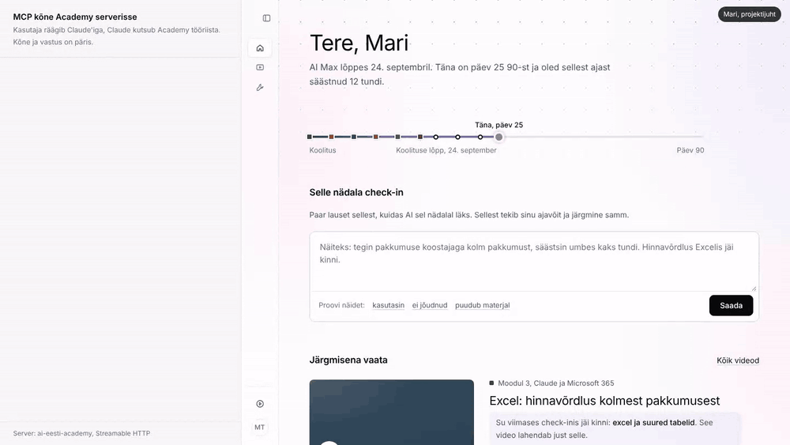

# AI Eesti Academy

Koolitusjärgne töölaud AI Eesti klientidele: **koolitus lõpeb, 90 päeva algab.**

See repo on Academy töötav prototüüp: veebileht, backend koos andmebaasiga ja **MCP server**. MCP serveri kaudu saab töötaja teha oma nädala check-ini otse Claude'i vestluses. Check-in jõuab kohe juhi, omaniku ja AI Eesti vaatesse.



*Vasakul on päris MCP tööriistakõne ja serveri vastus. Paremal on Academy, mis uueneb ise. Sama video on MP4-na failis `docs/mcp-demo.mp4`.*

---

## Mida see teeb

| Kes | Veebis | Claude'is (MCP tööriistad) |
|---|---|---|
| Tiimiliige | 90 päeva teekond, nädala check-in, järgmine video koos põhjusega, salvestused peatükkide ja slaididega | `submit_checkin`, `get_next_step`, `get_my_progress`, `find_material` |
| Juht | Kes kasutab, kes on vaikne, kus tiim kinni jääb | + `get_team_overview`, `request_workshop`, `feature_tool` |
| Omanik | Kas koolitus tasub end ära: omaosalus, tasuvuspäev, prognoos | + `get_roi` |
| AI Eesti | Sisulüngad kõigilt klientidelt: millest teha järgmine kiirjuhend | `get_content_gaps`, `get_roi`, `get_team_overview` |

Iga kasutaja näeb ainult oma rolli tööriistu. Lisaks on olemas prompt **"Nädala check-in"** (`nadala-check-in`): Claude küsib kaks küsimust ja salvestab vastused.

**Check-ini teekond:**

1. Mari ütleb Claude'ile: *"Tegin kolm pakkumust, igaüks säästis 40 minutit. Exceli hinnavõrdlus jäi kinni."*
2. Claude täidab väljad (2 h, "Pakkumuse koostamine", takistus "Excel") ja kutsub `submit_checkin`.
3. Server salvestab check-ini ning leiab video ja peatüki, mis takistuse lahendab, koos slaidinumbritega. Kui sobivat materjali pole, läheb teema AI Eesti sisulünkade nimekirja. Kui sama teemat on küsinud ka teised, liidetakse küsijad kokku.
4. Andrese (juht) vaates on Mari rida märgiga "Just Claude'ist". Toomase (omanik) tasuvusarvutus liigub ja AI Eesti näeb uut lünka.

## Käivitamine (2 minutit)

Vaja on **Node.js 22.5 või uuemat** (andmebaas on Node'i sisseehitatud SQLite).

```bash
npm install
npm start
```

- Veebileht: http://localhost:3000
- MCP demo kõrvuti vaatega: http://localhost:3000/demo
- Testid: `npm test`
- Näidisandmed algseisu: `npm run reset`

Andmed on näidisettevõttelt **Kaldaranna Ehitus** (12 inimest, AI Max). Demo "täna" on koolitusjärgne päev 25.

## Ühendamine Claude'iga

### Claude Desktop (kohalik, kõige kiirem)

Lisa faili `~/Library/Application Support/Claude/claude_desktop_config.json` (Windowsis `%APPDATA%\Claude\claude_desktop_config.json`):

```json
{
  "mcpServers": {
    "ai-eesti-academy": {
      "command": "node",
      "args": ["--no-warnings=ExperimentalWarning", "/TÄIELIK/TEE/REPONI/src/stdio.js"],
      "env": { "ACADEMY_TOKEN": "demo-mari" }
    }
  }
}
```

Taaskäivita Claude Desktop ja kirjuta: *"Teeme mu Academy nädala check-ini."* Kui samal ajal töötab ka `npm start`, näed muudatust kohe veebis, sest mõlemad kasutavad sama andmebaasi.

### Claude'i custom connector (veeb, mobiil, Desktop)

Server peab olema internetist kättesaadav (vt "Avalik server" allpool). Seejärel:

- **Isiklik konto:** Customize → Connectors → Add custom connector → URL `https://SINU-SERVER/mcp/demo-mari`
- **Team/Enterprise:** omanik lisab selle: Organization settings → Connectors → Add → Custom.

Token on demos URL-is (`/mcp/<token>`), et connector töötaks valikuga "No sign-in". Demo tokenid:

| Token | Kasutaja | Roll |
|---|---|---|
| `demo-mari` | Mari Tamm, projektijuht | tiimiliige |
| `demo-kristel` | Kristel Lepp, hankespetsialist | tiimiliige |
| `demo-andres` | Andres Kask, tegevjuht | juht |
| `demo-toomas` | Toomas Vaher, omanik | omanik |
| `demo-aieesti` | AI Eesti meeskond | AI Eesti |

MCP endpoint toetab ka päist `Authorization: Bearer <token>` aadressil `/mcp`.

### Avalik server

- **Render:** New → Blueprint → vali see repo (`render.yaml` on olemas). Tasuta plaanis algab andmebaas iga deploy'ga uuesti näidisandmetest.
- **Docker:** `docker build -t academy . && docker run -p 3000:3000 academy`

## Kuidas check-ini loetakse

Kolm teed, parimast lihtsamani:

1. **MCP kaudu** täidab Claude väljad vestluse põhjal ise (tunnid, kasutusjuht, takistus) ja küsib vajadusel üle. Server ainult kontrollib ja salvestab.
2. **Veebist**, kui `ANTHROPIC_API_KEY` on seatud: serveri poolel loeb teksti Claude (Messages API, mudel `ACADEMY_MODEL`, vaikimisi `claude-haiku-5-5`).
3. **Ilma võtmeta** kasutatakse reeglipõhist lugejat. Näiteks "neli pakkumust, iga kord 40 minutit" annab 2,5 h. Demo jaoks sellest piisab.

Materjali leidmiseks on märksõnaotsing salvestuste peatükkidest ja kiirjuhenditest. Kui skoor jääb alla läve, ei pakuta suvalist videot. Selle asemel tekib sisulünk, sest ausalt "seda veel pole" on parem kui vale video.

## Ülesehitus

```
src/
  server.js    Express: veebileht, REST API, MCP (Streamable HTTP, stateless)
  mcp.js       MCP tööriistad ja prompt, rollipõhiselt
  stdio.js     MCP üle stdio (Claude Desktop)
  checkin.js   check-ini lugemine, materjali sobitamine, lüngad
  logic.js     tasuvus, tiimi ülevaade, järgmine samm, otsing
  db.js        SQLite skeem ja näidisandmed (data/seed.json)
web/           veebilehe lähtekood (parts/) ja build
public/        demo.html; index.template.html tekib buildiga
test/          node:test, 9 testi (rollid, 401/403, check-in → juht → lünk, tasuvus)
```

**REST API:** `GET /api/state`, `GET /api/version`, `POST /api/checkins`, `GET /api/next`, `GET /api/me`, `GET /api/material?q=`, `GET /api/team`, `GET /api/roi`, `GET /api/gaps`, `POST /api/workshops`, `POST /api/tools/:id/feature`.

Andmemudel: organisatsioon → kasutajad (roll: member, manager, owner, aieesti) → check-inid (kasutus, tunnid, takistus, soovitatud video ja peatükk, allikas `web`/`mcp`) → sisulüngad (teema, küsijate arv, ettevõtted, olek). Õppematerjalid (salvestused peatükkide, slaidide ja harjutustega ning kiirjuhendid) on sisuhalduse andmed.

## Piirid (ausalt)

- **Autentimine on demo jaoks.** Tokenid on fikseeritud ja veebis saab rolli vahetada. Päris tootes tuleb OAuth (Claude'i custom connector toetab seda) ja `ACADEMY_DEMO=off`.
- Videod on kohatäited. Slaidinumbrid ja harjutused on näidisandmed.
- Ühe ettevõtte andmed. Mitme kliendi tugi on mudelis olemas (`org_id`), aga liides näitab üht.
- Kasutus tuleb praegu check-inist. Enterprise klientidel saab järgmise sammuna lisada Claude'i Analytics API, et kasutus ja Skillide statistika tuleksid automaatselt.

## Järgmised sammud

1. OAuth ja päris kasutajakontod (AI Eesti klientide nimekiri).
2. Piloot ühe AI Maxi kliendiga: 4 nädalat päris check-ine Claude'ist.
3. Koolituspäeva salvestus → transkriptsioon → Claude jagab selle peatükkideks ja seob slaididega.
4. Analytics API ühendus Enterprise klientidele.
